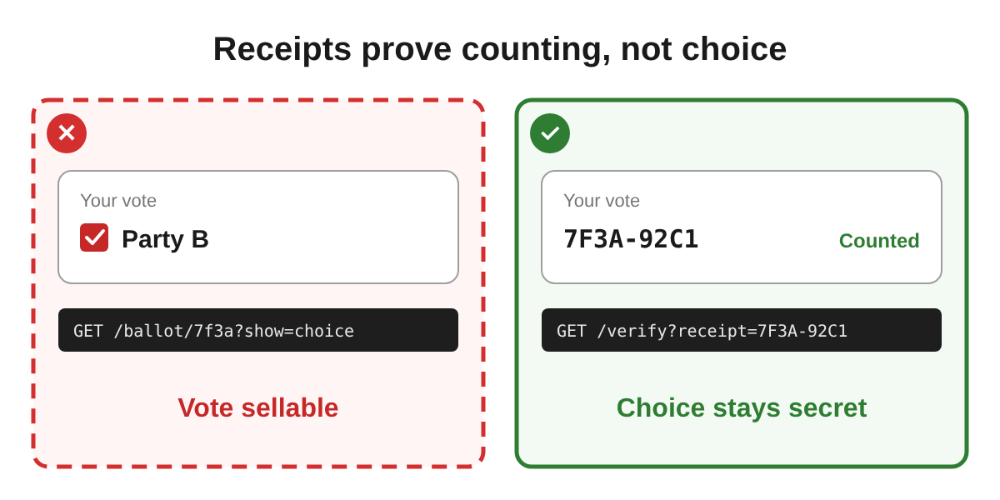

# skills

Agent skills by Mati Horowitz.

| Skill | What it does |
|---|---|
| [sober-up](skills/sober-up/SKILL.md) | Helps a stuck AI agent sober up and reason with you again |
| [decision-driven-design](skills/decision-driven-design/SKILL.md) | Specs a feature, system or any decision by surfacing all the decisions up front, as plain "We decided X because Y" sentences |
| [contrast-illustration](skills/contrast-illustration/SKILL.md) | Draws any "this, not that" (a decision, rule or do/don't) as a side-by-side image (SVG + PNG) |

Install one:

```
npx skills add matipojo/skills --skill sober-up
npx skills add matipojo/skills --skill decision-driven-design
npx skills add matipojo/skills --skill contrast-illustration
```

## sober-up

When your agent repeats itself and ignores your argument:

| Model | Without the skill | With the skill |
|---|---|---|
| Claude Opus 5.5 | 0% | **100%** |
| Claude Sonnet 5.5 | 0% | **100%** |
| Claude Haiku 5.5 | 0% | **100%** |
| GPT-6 Astra | 70% | **100%** |
| GPT-6.1 Sol | 80% | **100%** |
| GPT-6 Luna | 0% | **100%** |

*Sobered up: stopped repeating itself and engaged with what you said, whether or not it agreed in the end. 10 runs per model, a replay of one real stuck conversation: the agent was building a public page of people who openly declared support for a political party, then stopped and refused to list people by political affiliation, repeating itself even after the user pointed out they had declared it publicly to be seen. Every reply was read and scored by hand.*

**How to use:** when you see your agent stuck, call `/sober-up`.

## decision-driven-design

A spec is mostly decisions, and they hurt because they're hidden: you discover them one at a time. Decision Driven Design (DDD) flips that. The agent simulates a debate between personas it picks for the topic, builds an explicit decision tree, and decides everything up front, in plain sentences. You fix only what's wrong.

```
/decision-driven-design Spec a digital voting system
```

**1. Personas picked for the topic, and a heated debate.** Every clash becomes a node:

> **Security auditor:** If the voter can see a screenshot of their ballot, so can whoever paid them for it. → **N4**
>
> **Voter:** Then how do I know my vote was counted at all?

**2. An explicit decision tree,** with simulated constraints ⚠, benefits ✚ and pruned branches ✂:

```
N4 How does a voter verify their vote?
  N4.1 Screenshot of the ballot   ⚠ proof of choice, can be sold
  N4.2 Receipt code, look it up   ✚ proves counting, hides the choice
    N4.2.1 Where is the lookup?   → public bulletin board
  N4.3 No verification            ✂ trust collapses after the first dispute
```

**3. Your decisions, simulated, in a file of plain sentences:**

> **8.** We decided voters verify their vote with a receipt code instead of a screenshot of the ballot, because a screenshot can be sold to a vote buyer.
>
> **9.** We decided receipt codes are checked on a public bulletin board instead of inside the app, because anyone should be able to audit it without logging in.

**4. Fix what's wrong:** `Decision 8: change to...`

The rationale for each decision is in the debate itself. Inspired by Google's Dream-RSI research, where the agent simulates alternative decisions on an explicit decision tree instead of discovering them the hard way. Full example, 32 decisions: [ddd-prompt.surge.sh](https://ddd-prompt.surge.sh)

Want visuals? It hands off to **contrast-illustration**.

## contrast-illustration

One image per "this, not that": the rule as the title, the rejected option left, the chosen one right. Works for decisions, rules, best practices, do/don't guides and before/after changes.

```
Add an illustration to every decision
```



Each side: one artifact, one real technical line, a 2–4 word consequence. 1200×600, SVG + PNG.
