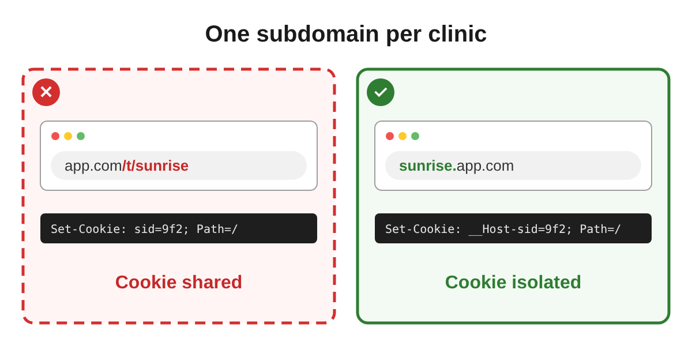

# skills

Agent skills by Mati Horowitz.

| Skill | What it does |
|---|---|
| [sober-up](skills/sober-up/SKILL.md) | Helps a stuck AI agent sober up and reason with you again |
| [decision-debate](skills/decision-debate/SKILL.md) | Plans any topic through a heated persona debate and hands you plain "We decided X because Y" sentences |
| [decision-illustration](skills/decision-illustration/SKILL.md) | Turns every decision into a rejected-vs-chosen illustration (SVG + PNG) |

Install one:

```
npx skills add matipojo/skills --skill sober-up
npx skills add matipojo/skills --skill decision-debate
npx skills add matipojo/skills --skill decision-illustration
```

## sober-up

When your agent repeats itself and ignores your argument:

| Model | Without the skill | With the skill |
|---|---|---|
| Claude Opus 5.5 | 0% | **100%** |
| Claude Sonnet 5.5 | 0% | **100%** |
| Claude Haiku 5.5 | 0% | **100%** |
| GPT-6 Astra | 70% | **100%** |
| GPT-6.1 Sol | 80% | **100%** |
| GPT-6 Luna | 0% | **100%** |

*Sobered up: stopped repeating itself and engaged with what you said, whether or not it agreed in the end. 10 runs per model, a replay of one real stuck conversation: the agent was building a public page of people who openly declared support for a political party, then stopped and refused to list people by political affiliation, repeating itself even after the user pointed out they had declared it publicly to be seen. Every reply was read and scored by hand.*

**How to use:** when you see your agent stuck, call `/sober-up`.

## decision-debate

Plan anything by letting biased personas fight it out, then get only the decisions.

```
/decision-debate Plan a booking app for small clinics
```

**1. The debate** (5–7 personas, every clash becomes a decision node):

> **Security lead:** A path prefix means one cookie for every clinic. One shared laptop at the front desk and clinic A is logged into clinic B. → **D1**
>
> **Builder:** Subdomains mean wildcard TLS and DNS for every new clinic. We're two developers.

**2. The tree** (wide and deep, with simulated constraints ⚠, benefits ✚ and pruned branches ✂):

```
D1 How are clinics separated?
  D1.1 Path prefix /t/{clinic}      ⚠ sessions shared across clinics
  D1.2 Subdomain {clinic}.app.com   ✚ per-clinic branding comes free
    D1.2.1 Custom domains?          ✂ no: support cost too high for v1
  D1.3 Deployment per clinic        ✂ 10× ops cost
D2 Who pays? ...  (14 more nodes)
```

**3. Your decisions, simulated** from your stated priorities (override any by ID: `D1 → 1.1`).

**4. The result, `decisions.md`:**

> **D1.** We decided each clinic gets its own subdomain instead of a path prefix, because a login at one clinic must never be valid at another.
>
> **D1.2.1.** We decided not to support custom domains in v1, because each one is a support ticket.
>
> **D2.** We decided to charge per clinic instead of per seat, because owners refuse to count receptionists.

Want visuals? It hands off to **decision-illustration**.

## decision-illustration

One illustration per decision: the rule as the title, the rejected option left, the chosen one right.

```
Add an illustration to every decision in decisions.md
```



Each side: one artifact, one real technical line, a 2–4 word consequence. 1200×600, SVG + PNG, added under each decision in the file.
